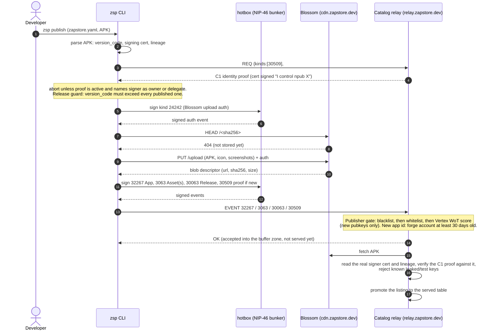
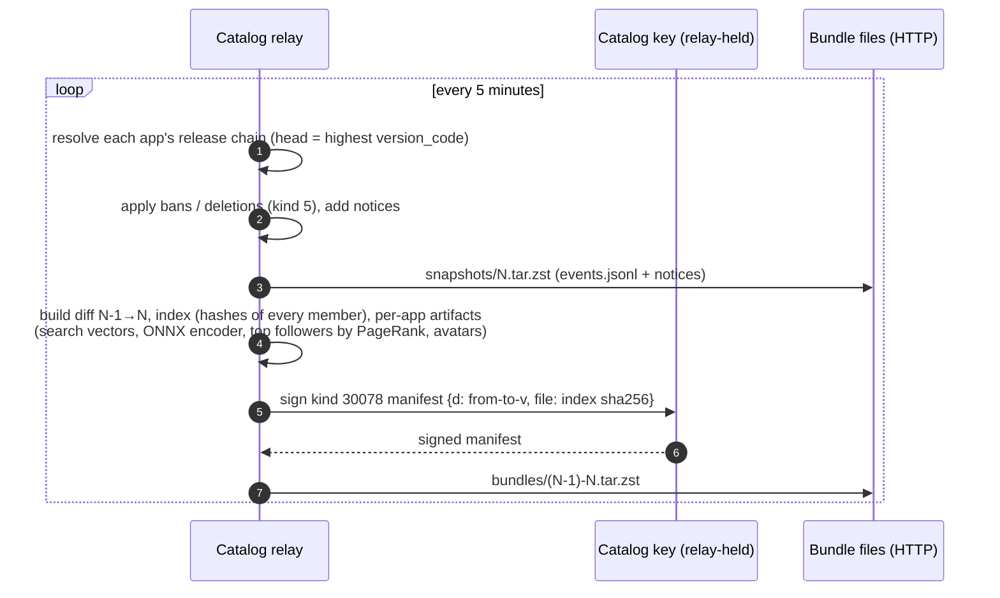
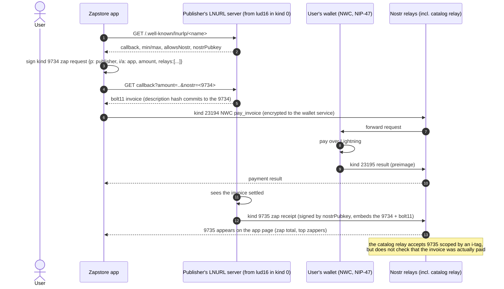

# Zapstore over Nostr: sequence diagrams (as of Nov 2026)

Source: the zapstore/{zapstore,zsp,relay,hotbox} repos at their 2026-11-07 HEAD, and NIP-82 draft PR #2526. Zapstore's private `product/specs` were not available, so search ranking and the bundle diff schema are not shown in detail.

## 1. Publish a release (developer → relay)



## 2. Catalog snapshotting (relay, every 5 min)



## 3. Phone sync, search, trust check, install

```mermaid
sequenceDiagram
    autonumber
    actor U as User
    participant P as Zapstore app (iolite, local SQLite)
    participant R as Catalog relay
    participant V as Vertex DVM
    participant BL as Blossom / asset url
    participant A as Android package installer

    Note over P: First run: an embedded seed bundle, catalog pubkey pinned from its manifest
    P->>R: GET /v1/bundle?from=<last epoch>
    R-->>P: tar.zst (30078 manifest + index + diff.jsonl + artifacts)
    P->>P: verify manifest sig against the pinned catalog key, epoch continuity,<br/>every member hash, every event sig, then import
    U->>P: search "notes app"
    P->>P: on-device ranking: exact name/app id, prefix, one-edit, facts + vector dot product
    P-->>U: results (no query leaves the phone)
    U->>P: open app page
    P->>V: kind 5312 "who ranks highest among the people following publisher X, as I see the graph"
    V-->>P: ranked follower list
    Note over P: fallback: scan follow lists (kind 3) of people I follow for a p-tag on X
    U->>P: Install
    P->>BL: GET APK (url, or Blossom GET /<sha256>; optionally over Tor)
    BL-->>P: APK bytes (hashed while downloading)
    P->>P: sha256 == x tag? APK signer cert == apk_certificate_hash?<br/>C1 proof valid → "Claimed by the developer"
    P->>A: install / update (signer must match the installed copy)
```

## 4. Zap (NIP-57 tip) to a publisher


